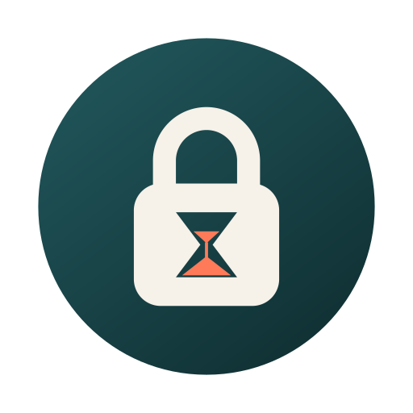
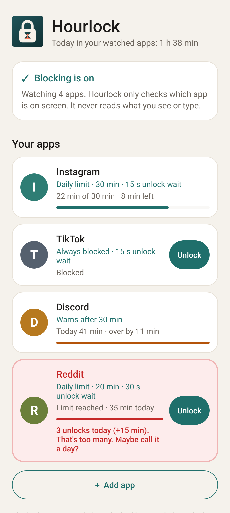
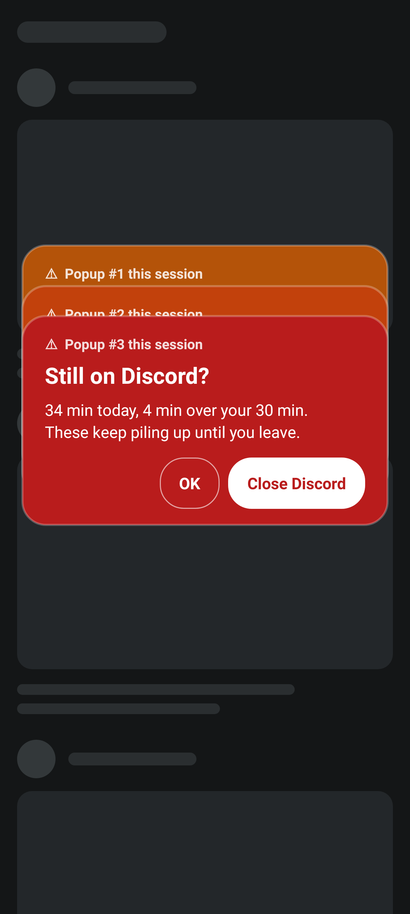
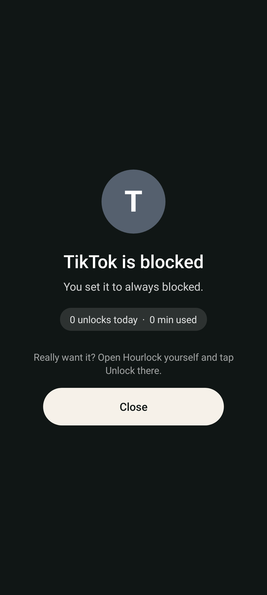
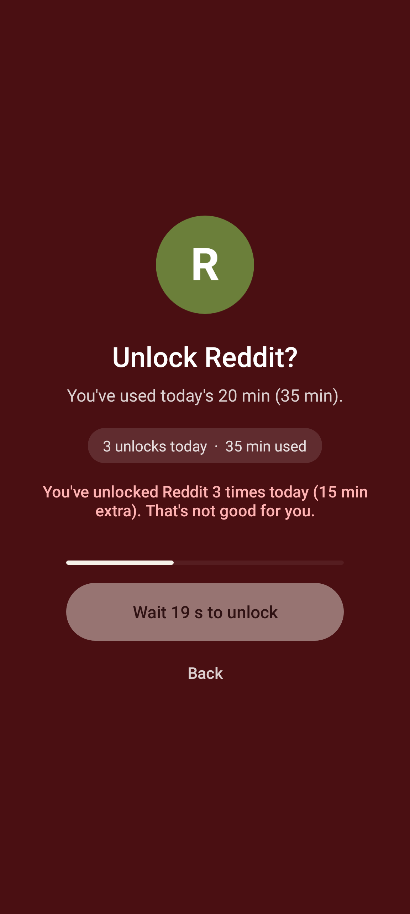

<p align="center"></p>

<h1 align="center">Hourlock</h1>

<p align="center">A free, open-source app blocker for Android.<br>
No Google services, no subscription, no account, no ads, no trackers, and <b>no permissions at all</b> (not even internet).</p>

<p align="center">Made by <a href="https://github.com/RealKHFan">RKF</a> with help from Claude (Anthropic).</p>

Hourlock lets you block apps, give them a daily time limit, or get nagged
when you overdo it. It was made on GrapheneOS and works on any Android 10+
phone, with or without Google services. The whole app is about 60 KB.

<p align="center">




</p>
<p align="center"><sub>Sample data. On your phone you'll see the real app icons.</sub></p>

## Modes

Every app you add gets one of four modes:

| Mode | What happens |
|---|---|
| **Not restricted** | Only counts today's minutes |
| **Warn me** | Never blocks. After the daily threshold (default 30 min) a popup appears, and another one stacks on top every 2 minutes you stay |
| **Daily time limit** | Free use until the limit (default 30 min), then blocked |
| **Always blocked** | Blocked all the time |

On first start, Instagram, TikTok and Discord are added (if installed) as
"Not restricted". Add any other app with **+ Add app**.

## Unlocking is deliberately annoying

- Opening a blocked app sends you home and shows a notice with only a
  **Close** button. There is no unlock button there.
- To unlock, you have to open Hourlock yourself, tap **Unlock** on the app and
  wait out its timer (15 s by default, 5 s to 1 h per app). Leaving the screen
  restarts the timer.
- An unlock gives 5 minutes (adjustable) of *in-app* time. The minutes only
  count down while the app is on screen. Leftovers expire at midnight.
- From the 3rd unlock of a day, the app turns red.

## Changing rules

Stricter changes (stricter mode, fewer minutes, longer wait) apply instantly.
Looser changes need a **3-minute countdown** that restarts if you leave the
screen. That covers a less strict mode, more minutes, a shorter wait, or
removing an app. All counters reset at midnight.

## Install

1. Download the latest `Hourlock-x.y.apk` from
   [Releases](../../releases) on your phone and open it. Allow "Install unknown
   apps" for your browser or file manager when asked.
2. Open Hourlock, tap **Accessibility**, then **Hourlock**, and try the switch.
   On Android 13 and newer it says "Restricted setting", because the app
   didn't come from an app store.
3. Back in Hourlock, tap **App info**, then **⋮** (top right), then **Allow restricted
   settings**, and confirm.
4. Tap **Accessibility** again, then **Hourlock**, and turn it on. Android warns that
   it can see your screen; Hourlock only checks which app is open.
5. Tap each app and pick its mode.

### Check that your APK is genuine

Every official Hourlock APK is signed with this certificate (SHA-256):

```
7D:90:96:F4:72:5B:73:D1:3D:FB:BC:FE:92:1D:5D:46:C9:0A:BC:67:06:F1:19:2C:5F:48:8C:07:18:D7:CA:49
```

Check it with an app like AppVerifier, or with
`apksigner verify --print-certs Hourlock-x.y.apk`. If it doesn't match, don't install it.

### Notes for some phones

- **Battery savers.** Xiaomi/Redmi/POCO (HyperOS/MIUI), Huawei, OnePlus and
  some Samsung phones may switch the service off to save battery. If blocking
  stops working, set Hourlock's battery usage to *Unrestricted* / *No
  restrictions*, and on Xiaomi also enable *Autostart*.
- **Profiles.** Hourlock only sees apps in the profile it's installed in.
  For apps in a work profile, a GrapheneOS profile or Private Space, install
  Hourlock in that profile too.
- **Menu names** differ a bit between brands, but "Allow restricted settings"
  is always in the ⋮ menu of the app's App info page.
- Android 9 and older aren't supported.

## Privacy

Hourlock uses Android's accessibility service only to see **which app** has a
window on screen (its package name). It never reads, stores or sends text or
anything else from other apps. It declares no permissions, has no internet
access, and keeps everything in its own private storage on your phone.

## Honest limits

- Android always lets you turn an accessibility service off or uninstall an
  app. Without root or device-owner setup, no app can prevent that. Hourlock
  is a strong speed bump, not a jail.
- Websites in the browser (instagram.com etc.) aren't blocked.
- Apps in picture-in-picture mode are ignored, because going home can't close them.
- This is a young project. The rules logic is covered by 95 automated tests,
  but please report anything odd on your phone in [Issues](../../issues).

## Build it yourself

No Gradle and no Google libraries: just a JDK (17+) and three pieces of the
Android SDK (`platforms;android-33` and `build-tools;36.0.0`).

```sh
ANDROID_JAR=$ANDROID_HOME/platforms/android-33/android.jar \
BUILD_TOOLS=$ANDROID_HOME/build-tools/36.0.0 \
./build.sh
```

`build.sh` runs the tests, then compiles, packages, aligns and signs
`build/Hourlock.apk`. Without the project key it signs with a throwaway local
key, which works fine but can't update an install of an official release.

Every push is tested and built by [GitHub Actions](.github/workflows/build.yml).
Releases are signed on the maintainer's own computer and uploaded by hand,
so the signing key never touches GitHub.

### Code tour

| File | What it does |
|---|---|
| `src/app/unscroll/Engine.java` | All the rules, in plain Java with tests |
| `src/app/unscroll/BlockerService.java` | Watches which app is open, books time, blocks, warns |
| `src/app/unscroll/BlockActivity.java` | The Close-only notice and the unlock screen |
| `src/app/unscroll/MainActivity.java` | App list, editing, the 3-minute wait, adding apps |
| `src/app/unscroll/WarnOverlay.java` | The stacking Warn popups |
| `src/app/unscroll/Store.java` | Saves rules and today's counters |
| `test/app/unscroll/EngineTest.java` | The tests |

The app ID is `app.unscroll`, after the project's working title, so the
early installs keep updating.

## License

Copyright (C) 2026 RKF ([RealKHFan](https://github.com/RealKHFan)). Written with help from Claude.

Hourlock is free software: you can redistribute it and/or modify it under the
terms of the GNU General Public License as published by the Free Software
Foundation, either version 3 of the License, or (at your option) any later
version. See [LICENSE](LICENSE).
